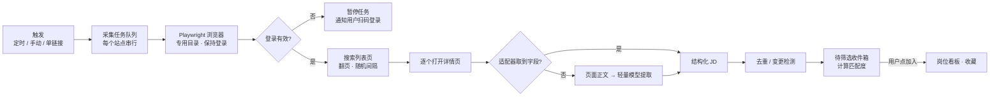
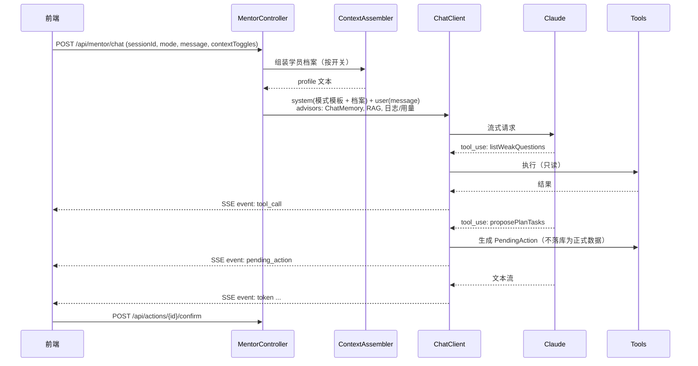
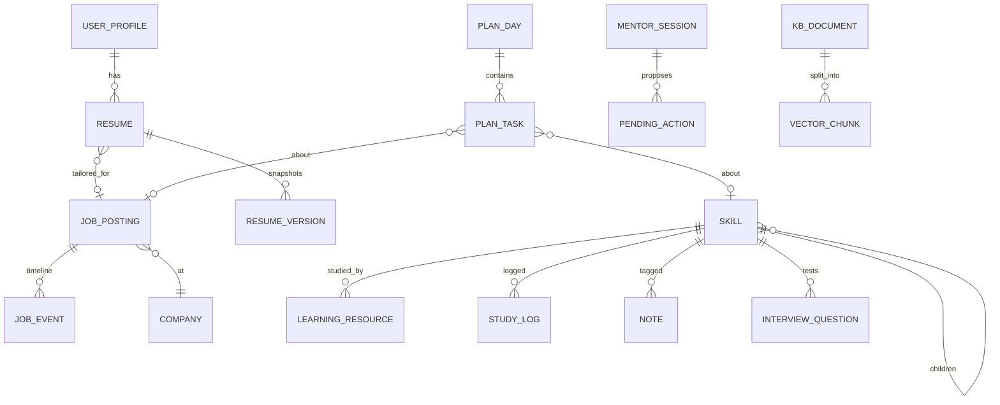

# Bucky 成长台 · 产品需求文档（PRD）

> 项目代号：`bucky_improvement`
> 版本：v0.2（新增岗位采集） · 日期：2026-11-12
> 形态：本地运行的单体 Web 应用（一个 jar 启动，浏览器访问 `http://localhost:8080`）
> 配套原型：[`docs/prototype/index.html`](prototype/index.html)（浏览器直接打开，可点击切换页面）

---

## 1. 背景与目标

### 1.1 背景
求职期同时要做几件事：投递和跟进岗位、按岗位改简历、每天安排学习和刷题、准备面试、定期复盘。这些信息通常散在 Excel、备忘录、浏览器书签和聊天记录里，没人帮你把它们串起来。

### 1.2 产品定位
一个**本地优先**的求职 + 学习工作台。把「工作信息、简历、每日计划、学习进度」四类数据结构化存下来，再接一个**能看到这些数据的 AI 导师**，负责答疑、规划、复盘、模拟面试和自动写总结。

### 1.3 目标
| 目标 | 衡量方式 |
|---|---|
| 求职过程可追踪 | 每个岗位有状态、下一步动作和时间线；漏斗数据一眼可见 |
| 学习过程可量化 | 技能等级、学习时长、资料完成度、题库掌握度都能统计 |
| 每天有计划、有复盘 | 计划完成率、复盘填写率 |
| AI 导师有上下文 | 导师回答时自动带上学习进度、计划、求职进展，并能引用个人知识库 |
| 自动归纳总结 | 日报 / 周报 / 月报一键生成，结论标注数据来源 |
| 顺便当作作品 | 技术栈覆盖 Spring AI 2.0、RAG、MCP、Tool Calling，可写进简历、可在面试中讲 |

### 1.4 非目标（v1 不做）
- 多用户、注册登录、云端部署（只有本机单用户）
- 自动海投、自动打招呼 / 自动沟通（只采集岗位信息，投递动作由本人完成）
- 破解验证码、绕过风控、批量注册账号
- 移动端 App（Web 做响应式即可）

> 变更记录（v0.2）：「爬取招聘网站」从非目标改为计划内功能，见 3.9。

---

## 2. 用户与场景

**用户画像**：Java 后端工程师，3~8 年经验，正在找工作；同时想补齐 AI 应用开发（Spring AI / RAG / Agent）方向的能力。

| # | 场景 | 用户动作 | 系统响应 |
|---|---|---|---|
| S1 | 看到一个合适岗位 | 粘贴 JD 文本或链接 | AI 解析出公司、职级、薪资、技能要求，和我的技能做匹配，生成「差距清单」，进入看板「收藏」列 |
| S2 | 投简历前 | 选岗位 → 选简历版本 | AI 给出匹配度和修改建议，可一键派生一份「定制版简历」 |
| S3 | 早上开工 | 打开首页 | 看到今日计划、今天的面试 / 笔试提醒、导师的晨间建议 |
| S4 | 学习中遇到问题 | 在导师页提问 | 导师结合我的笔记（RAG）回答，并标注引用 |
| S5 | 晚上复盘 | 勾选任务、填写复盘 | 导师点评今天，并起草明日计划（需我确认才写入） |
| S6 | 面试前一天 | 导师 →「模拟面试」模式 | 按目标岗位 JD 和我的薄弱项出题、追问、打分，错题进入题库 |
| S7 | 周日 | 总结页 → 生成周报 | 汇总本周投递、面试、学习时长、技能变化、问题与下周计划 |
| S8 | 每天早上 | 无需操作（采集订阅定时运行） | 系统打开浏览器，按订阅的关键词和城市在招聘网站上搜索，抓到的新岗位进入「待筛选」，带好匹配度 |
| S9 | 在招聘网站上看到一个岗位 | 复制链接粘贴进来 | 系统用浏览器打开该链接，抓取 JD 并解析，生成岗位卡片 |

---

## 3. 信息架构与功能模块

```
Bucky 成长台
├── 首页 · 今日总览          Dashboard
├── 工作信息                  Jobs
│   ├── 岗位看板（按状态）
│   ├── 岗位详情（JD 解析 / 匹配度 / 时间线 / 面试记录）
│   ├── 岗位采集（采集订阅 / 单链接抓取 / 待筛选收件箱 / 运行记录）
│   └── 公司库
├── 个人简历                  Resume
│   ├── 主简历（结构化编辑）
│   ├── 定制版本（从主简历派生，关联岗位）
│   └── AI 批改 / JD 匹配 / 导出 PDF·Markdown
├── 每日计划                  Plan
│   ├── 日视图（任务 + 番茄钟）
│   ├── 周视图
│   └── 晚间复盘
├── 学习进度                  Learning
│   ├── 技能矩阵（等级 0~5）
│   ├── 学习资料（书 / 课 / 文档，进度）
│   ├── 学习打卡（热力图）
│   ├── 知识卡片（笔记，RAG 语料）
│   └── 面试题库（掌握度、复习时间）
├── 导师                      Mentor（AI）
│   ├── 对话（多会话、多模式）
│   ├── 上下文面板（导师能看到什么，可开关）
│   └── 工具调用 / 写操作确认
├── 总结归纳                  Summary
│   └── 日报 / 周报 / 月报（AI 生成 + 可编辑）
└── 设置                      Settings
    ├── 模型配置、用量统计
    ├── 知识库（RAG 文档管理）
    └── MCP 服务器管理
```

### 3.1 模块一：工作信息（Jobs）

**核心对象**：岗位（JobPosting）、岗位事件（JobEvent）、公司（Company）

| 功能 | 说明 | 优先级 |
|---|---|---|
| 岗位看板 | 列：收藏 → 已投递 → 笔试/测评 → 面试中 → Offer → 已结束；拖拽改状态，自动记一条事件 | P0 |
| 新增岗位 | 手动填写；或粘贴 JD 文本 / 链接 → AI 解析（结构化输出） | P0 |
| JD 解析 | 提取：公司、岗位、城市、薪资区间、年限、技能要求（必需 / 加分）、职责要点 | P0 |
| 匹配分析 | 技能要求 vs 我的技能矩阵 → 匹配度百分比 + 差距清单；差距可一键加入学习计划 | P1 |
| 时间线 | 投递、笔试、一面、二面、HR 面、Offer、拒绝，每条带时间和备注 | P0 |
| 面试记录 | 每轮面试的问题、我的回答、面试官反馈、自评；问题可一键进题库 | P1 |
| 下一步提醒 | 每个岗位有「下一步动作 + 截止时间」，到期出现在首页和今日计划 | P0 |
| 求职漏斗 | 各状态数量、转化率、平均停留天数 | P1 |

**岗位状态机**
```
收藏 ──投递──▶ 已投递 ──▶ 笔试/测评 ──▶ 面试中 ──▶ Offer ──▶ 已结束(接受)
  │              │             │            │         └──▶ 已结束(放弃)
  └──────────────┴─────────────┴────────────┴──▶ 已结束(被拒 / 不再跟进)
```

### 3.2 模块二：个人简历（Resume）

| 功能 | 说明 | 优先级 |
|---|---|---|
| 结构化主简历 | 分块：基本信息、求职意向、技能清单、工作经历、项目经历、教育、证书；每块可排序和隐藏 | P0 |
| 版本管理 | 从主简历派生「定制版」并关联岗位；每次保存留快照，可对比、回滚 | P1 |
| AI 批改 | 按 STAR 原则检查项目描述；找出没有量化结果、动词弱、和岗位无关的句子 | P0 |
| JD 匹配 | 选一个岗位 → 关键词覆盖率、缺失项、建议改写（逐条，可采纳 / 忽略） | P1 |
| 导出 | Markdown、PDF（后端模板渲染）；可选 2~3 套模板 | P1 |
| 简历入库 | 简历内容自动进入 RAG，导师模拟面试时会按简历追问 | P1 |

### 3.3 模块三：每日计划（Plan）

| 功能 | 说明 | 优先级 |
|---|---|---|
| 今日任务 | 分类：学习 / 求职 / 面试 / 刷题 / 其他；预估时长、实际时长、状态；可关联技能或岗位 | P0 |
| 自动带入 | 岗位的「下一步动作」、到期的题库复习、面试日程自动出现在当天 | P1 |
| 番茄钟 | 选中任务开始计时，结束后时长累计到任务和学习记录 | P1 |
| 晚间复盘 | 三段：今天完成了什么 / 卡在哪 / 明天最重要的一件事；精力和心情 1~5 分 | P0 |
| AI 起草明日计划 | 导师根据复盘、未完成任务、学习目标、面试日程生成草案，用户确认后写入 | P1 |
| 周视图 | 一周任务分布、完成率、各分类时长 | P2 |

### 3.4 模块四：学习进度（Learning）

| 功能 | 说明 | 优先级 |
|---|---|---|
| 技能矩阵 | 两级技能树（如 Java 基础 > 并发）；当前等级、目标等级（0~5），附等级定义 | P0 |
| 学习资料 | 书 / 课程 / 视频 / 文档；总单元数、完成单元数、关联技能 | P0 |
| 学习打卡 | 每次学习记录：日期、技能、资料、时长、收获；首页和学习页展示热力图 | P0 |
| 知识卡片 | Markdown 笔记，可打标签、关联技能；保存后自动切片入向量库 | P1 |
| 面试题库 | 题目、参考答案、我的答案、掌握度（生 / 熟 / 掌握）、下次复习日期（简化版间隔重复） | P1 |
| 学习路线 | 导师根据目标岗位生成学习路线（阶段 → 技能 → 资料），用户确认后落到技能矩阵 | P2 |

**技能等级定义（0~5）**：0 没接触 · 1 听过概念 · 2 能照着文档用 · 3 能独立在项目中用 · 4 懂原理、能排查问题 · 5 能设计方案、能讲给别人听。

### 3.5 模块五：导师（Mentor · AI）

导师是这个产品的核心。它不是一个通用聊天框，而是一个**能读你数据、能调用工具、改数据前会先问你**的助手。

#### 3.5.1 导师模式
| 模式 | 用途 | 默认注入的上下文 |
|---|---|---|
| 答疑 | 技术问题、概念讲解 | 相关技能等级 + RAG 检索结果 |
| 规划 | 制定学习路线、周计划、明日计划 | 技能矩阵、近 7 天计划和学习记录、面试日程 |
| 复盘 | 点评今天 / 本周 | 当日计划完成情况、复盘内容、学习时长 |
| 模拟面试 | 按岗位出题、追问、打分 | 目标岗位 JD、简历、题库薄弱项 |
| 简历顾问 | 改简历、写项目亮点 | 简历内容、目标岗位 |
| 求职参谋 | 岗位选择、谈薪、跟进节奏 | 看板数据、Offer 信息 |

#### 3.5.2 上下文组装（Context Assembly）
每次请求，后端由 `MentorContextAssembler` 生成一段「学员档案」放进 system prompt：

```
[学员档案 · 2026-11-12]
目标：Java 高级后端 / AI 应用开发，期望城市：上海，期望薪资：35-45K
技能快照：Spring 4/5(目标5) · JVM 2/5(目标4) · 分布式 2/5(目标4) · Spring AI 2/5(目标4) ...
近 7 天：学习 11.5h（JVM 4h、Spring AI 5h、算法 2.5h），计划完成率 72%
今日计划：5 项，已完成 2 项
求职：进行中 12 个岗位；明天 14:00 某公司二面（Java 后端）
最近复盘的卡点：JVM 调优实战经验不足
```

- 上下文面板可**逐项开关**，用户知道导师看到了什么
- 快照之外的细节由导师按需**调用工具**获取，不全部塞进 prompt，以节省 token
- 档案文本稳定的部分放在前面，利于 Prompt Caching

#### 3.5.3 工具（Tool Calling）
| 工具 | 类型 | 说明 |
|---|---|---|
| `getLearningProgress(skill?)` | 读 | 技能等级、近期学习记录 |
| `getPlan(date)` | 读 | 某天计划和复盘 |
| `listJobs(status?)` / `getJob(id)` | 读 | 岗位和时间线 |
| `getResume(versionId?)` | 读 | 简历内容 |
| `searchKnowledge(query)` | 读 | RAG 检索（笔记、资料、面试记录） |
| `listWeakQuestions(skill?)` | 读 | 题库中掌握度低的题 |
| `proposePlanTasks(date, tasks[])` | **写·需确认** | 生成任务草案，前端弹确认卡片 |
| `updateSkillLevel(skill, level, reason)` | **写·需确认** | 建议调整技能等级 |
| `addInterviewQuestion(...)` | **写·需确认** | 模拟面试中的错题入库 |
| `createJobFromJd(text)` | **写·需确认** | 从 JD 创建岗位 |
| `searchCollectedJobs(keyword?, minMatch?)` | 读 | 查询采集收件箱里的岗位 |
| `fetchJobFromUrl(url)` | **写·需确认** | 用浏览器抓取一个岗位链接并生成岗位 |

**写操作统一走「提议 → 用户确认 → 执行」**：工具只生成 `PendingAction`，前端渲染确认卡片，用户点确认后由普通 REST 接口执行。

#### 3.5.4 记忆
- 短期：会话内消息（Spring AI ChatMemory，JDBC 持久化，按会话 ID 隔离，窗口裁剪）
- 长期：「导师笔记」——导师在复盘中总结出的结论（如“JVM 是当前最大短板”），用户确认后写入，下次进入档案

### 3.6 模块六：总结归纳（Summary）

| 类型 | 触发 | 内容 |
|---|---|---|
| 日报 | 晚间复盘后手动 / 定时 22:30 | 完成任务、学习时长、求职动作、卡点、明日重点 |
| 周报 | 周日手动 / 定时 | 投递和面试进展（漏斗变化）、学习时长分布、技能等级变化、本周亮点和问题、下周计划建议 |
| 月报 | 手动 | 月度趋势 + 阶段性评估 |

- 每条结论后面用小标签标注依据（如 `[计划 11-10]`、`[岗位 #12]`），点击跳到对应数据
- 生成后可编辑、导出 Markdown；保存后进入 RAG，下次周报可以和上周对比
- 汇总用轻量模型，评估和建议部分用主模型

### 3.7 首页（Dashboard）
今日计划进度、今日 / 明日日程（面试、笔试、截止）、求职漏斗、本周学习时长、导师晨间建议（每天首次打开时生成并缓存）、待处理事项（到期的下一步动作、待复习题目、待筛选的新岗位数）。

### 3.8 设置（Settings）
模型提供方和 Key、主模型 / 轻量模型选择、Embedding 配置、知识库文档管理（上传、重建索引）、MCP 服务器管理、采集浏览器和站点配置、Token 用量和费用统计、数据备份和导入导出。

### 3.9 岗位采集（浏览器爬取）

**目标**：不用每天手动刷招聘网站。系统驱动一个真实浏览器，用你自己的账号登录状态，按设定的条件搜索和打开岗位页面，把 JD 抓回来走已有的 JD 解析和匹配流程。

#### 3.9.1 功能
| 功能 | 说明 | 优先级 |
|---|---|---|
| 单链接抓取 | 粘贴招聘网站的岗位链接 → 浏览器打开 → 抓取 JD → 解析 → 生成岗位卡片（进入「收藏」） | P0 |
| 采集订阅 | 设置：站点、关键词、城市、薪资下限、经验要求、排除词（如“外包”）、每次最多条数、运行时间（如每天 08:30） | P1 |
| 手动运行 | 订阅列表上点「立即运行」，实时看进度（第几页、发现几条、新增几条） | P1 |
| 待筛选收件箱 | 采集结果不直接进看板，先进收件箱；每条带匹配度和差距；操作：加入收藏 / 忽略 / 永久屏蔽这家公司 | P1 |
| 去重和变更检测 | 同一岗位不重复入库；已入库岗位的 JD 或薪资变化时标记「有更新」；岗位下线时标记「已下架」 | P1 |
| 登录助手 | 首次使用或登录过期时，弹出可见的浏览器窗口，你手动扫码登录，登录状态保存在专用浏览器目录里 | P0 |
| 运行记录 | 每次运行的时间、页数、发现数、新增数、失败原因、截图（失败时） | P1 |
| 导师联动 | 导师可以调用「搜索采集结果」；晨间建议会提到“今天新采集到 3 个匹配度 80% 以上的岗位” | P2 |
| 智能抓取（实验） | 遇到没有适配器的网站时，导师通过 Playwright MCP 操作浏览器，自己找到岗位信息 | P2 |

#### 3.9.2 采集方式
| 方案 | 做法 | 用途 |
|---|---|---|
| **A. Playwright for Java + 专用浏览器目录**（默认） | `launchPersistentContext(~/.bucky/browser-profile)`，有头模式登录、之后可无头运行；登录状态（Cookie）保存在这个目录里 | 定时订阅、单链接抓取 |
| B. 连接你已打开的 Chrome | Chrome 以 `--remote-debugging-port=9222` 启动，Playwright `connectOverCDP` 连上去，直接用你日常浏览器的登录状态 | 网站对新设备风控严格时用 |
| C. Playwright MCP | 通过 Spring AI MCP Client 连接 Playwright MCP 服务器，由模型决定点哪里、读哪里 | 没有适配器的网站、一次性抓取；慢、费 token，不用于定时任务 |

**页面内容提取分两层**：
1. **站点适配器**（优先）：每个网站一个适配器，用 CSS 选择器取列表和详情字段。选择器写在配置文件里（`crawler/sites/*.yml`），网站改版时改配置即可，不用重新编译。
2. **大模型兜底**：选择器取不到字段，或网站没有适配器时，把页面正文（去掉导航、脚本后的文本）交给轻量模型，用和「粘贴 JD 解析」相同的结构化输出 `JdParseResult` 提取。



#### 3.9.3 运行规则
- **只抓公开展示的岗位信息**：岗位名、公司、薪资、城市、要求、JD 正文、发布时间。不抓 HR 的个人联系方式，不抓其他求职者的信息。
- **低频**：每个站点同一时间只跑一个任务；页面之间随机等待 3~8 秒；每次运行默认最多 5 页、50 条详情；每天每个站点默认最多运行 2 次。这些值在设置页可调，但有上限。
- **遇到验证码、滑块、登录失效就停**：暂停任务，截图，通知你在可见的浏览器窗口里手动处理，不做自动破解。
- **用你自己的账号**，只用于本人求职；各网站的用户协议对自动化访问的规定不同，启用某个站点前，设置页会提示先阅读该站点的协议。
- Playwright 的对象不是线程安全的：每个浏览器实例绑定一个专用线程，任务通过队列交给它，不在虚拟线程里直接并发操作页面。

#### 3.9.4 首批站点
先做一个站点的适配器跑通全流程，其他站点按需加：Boss 直聘、猎聘、拉勾、智联招聘、公司官网招聘页（通用适配器 + 大模型兜底）。具体先做哪个站点由你决定。

---

## 4. 原型与页面说明

可交互原型：`docs/prototype/index.html`。下表是页面清单和布局要点。

| 页面 | 路由 | 布局要点 |
|---|---|---|
| 今日总览 | `/` | 顶部问候 + 日期；左列今日计划和日程；右列导师晨间建议、求职漏斗、本周学习柱状图 |
| 工作信息 | `/jobs` | 工具栏（新增、粘贴 JD、筛选）；6 列看板；点卡片右侧滑出详情抽屉（JD 解析、匹配度、时间线） |
| 岗位采集 | `/jobs/collect` | 顶部单链接输入框；左侧采集订阅列表（状态、下次运行时间、立即运行）；中间待筛选收件箱（按匹配度排序，批量加入 / 忽略）；右侧运行记录和浏览器登录状态（原型待补） |
| 个人简历 | `/resume` | 三栏：版本列表 / 结构化编辑区 / AI 面板（匹配度、逐条建议） |
| 每日计划 | `/plan` | 顶部周日期条；任务列表按分类分组；右侧番茄钟 + 晚间复盘表单 |
| 学习进度 | `/learning` | 技能矩阵（当前 vs 目标）；打卡热力图；资料进度；题库掌握度 |
| 导师 | `/mentor` | 三栏：会话和模式 / 对话区（工具调用和引用以小标签显示，写操作显示确认卡片）/ 上下文面板（可开关） |
| 总结归纳 | `/summary` | 日 / 周 / 月切换；历史列表；正文带来源标注；重新生成、编辑、导出 |
| 设置 | `/settings` | 模型、Embedding、知识库、MCP 服务器、用量 |

主要页面的线框（ASCII）：

```
┌─ 导师 ───────────────────────────────────────────────────────────────────┐
│ 会话列表        │  对话                                  │ 导师能看到的   │
│ ─────────────  │  ┌────────────────────────────────┐    │ ☑ 技能快照     │
│ ● 规划本周      │  │我：明天二面，帮我过一遍 JVM      │    │ ☑ 今日计划     │
│ ○ JVM 答疑      │  └────────────────────────────────┘    │ ☑ 求职进展     │
│ ○ 模拟面试·A公司 │  ⚙ getJob #12   ⚙ listWeakQuestions    │ ☐ 简历全文     │
│                │  导师：根据 JD 和你的题库……  [笔记·G1]   │ ☑ 知识库 RAG   │
│ 模式           │  ┌ 待确认 ──────────────────────────┐   │ ────────────  │
│ [答疑][规划]    │  │ 向明日计划添加 3 个任务  [确认][改] │   │ 本次引用       │
│ [复盘][模拟面试] │  └──────────────────────────────────┘   │ · JVM 笔记 G1  │
│                │  [输入框……………………………………] [发送]      │ · 面试记录 #12 │
└──────────────────────────────────────────────────────────────────────────┘
```

```
┌─ 工作信息 ───────────────────────────────────────────────────────────────┐
│ [+ 新增岗位] [粘贴 JD 解析]   筛选：城市 ▾ 薪资 ▾ 标签 ▾                   │
│ 收藏(3)    已投递(5)   笔试/测评(2)  面试中(2)    Offer(1)   已结束(4)      │
│ ┌──────┐  ┌──────┐   ┌──────┐     ┌──────┐     ┌──────┐                 │
│ │公司  │  │      │   │      │     │二面 明天│     │      │                 │
│ │岗位  │  │      │   │      │     │匹配 82%│     │      │                 │
│ │30-45K│  │      │   │      │     └──────┘     └──────┘                 │
│ └──────┘  └──────┘   └──────┘                                           │
└──────────────────────────────────────────────────────────────────────────┘
```

**视觉规范（原型使用）**：墨蓝作主色、荧光笔黄作强调色（取「笔记本 + 荧光笔」的意象）；状态色单独一套（进行中 / 待办 / 风险 / 完成）；支持亮色和暗色；数字用等宽数字；卡片只用在看板、确认卡片这类「独立对象」上。

---

## 5. 技术架构

### 5.1 技术选型
| 层 | 选型 | 说明 |
|---|---|---|
| 语言 / 运行时 | Java 21 | 虚拟线程（`spring.threads.virtual.enabled=true`）、record、模式匹配、sealed |
| 框架 | Spring Boot 4.x + **Spring AI 2.0** | Spring AI 2.0 基于 Boot 4；具体 API 以 2.0 GA 文档为准 |
| 大模型 | Anthropic Claude（`spring-ai-starter-model-anthropic`） | 主模型 `claude-opus-5-5`，轻量任务（JD 解析、日报汇总、分类）用 `claude-haiku-5-5`；通过配置切换，也可接 Ollama 本地模型 |
| Embedding | Ollama 本地 `bge-m3`（中文效果好），可替换为云端 Embedding | Claude 不提供 Embedding 接口，需单独选型 |
| 数据库 | PostgreSQL 16 + pgvector（Docker Compose 一键启动） | 业务数据和向量放同一个库；Spring AI `PgVectorStore` |
| 迁移 | Flyway | |
| 持久层 | Spring Data JPA（简单 CRUD）+ JdbcClient（统计查询） | |
| 前端 | Angular 20（standalone 组件 + signals）+ HTML/SCSS | 自定义设计 token；图表 ECharts（ngx-echarts）；Markdown 渲染 ngx-markdown |
| 前后端一体 | `frontend-maven-plugin` 构建 Angular，产物复制到 `src/main/resources/static` | `mvn package` 产出单个 jar；开发时 `ng serve` 代理到 8080 |
| 流式输出 | SSE（`Flux<ServerSentEvent>`） | 导师对话逐字输出，工具调用事件也通过 SSE 推给前端 |
| 定时任务 | Spring `@Scheduled` | 晨间建议、日报、周报、采集订阅 |
| 浏览器自动化 | Playwright for Java（`com.microsoft.playwright`） | 岗位采集；专用浏览器目录保存登录状态；可选通过 CDP 连接本机 Chrome |
| PDF 导出 | Thymeleaf 模板 + OpenHTMLtoPDF | |

> 说明：Angular 本身用 TypeScript 写，最终产物是 HTML + JS，符合「html + angular + js」的要求。

### 5.2 总体架构

```mermaid
flowchart LR
  subgraph Browser["浏览器 · Angular SPA"]
    UI[页面组件] --> SVC[HTTP / SSE 服务]
  end
  subgraph App["Spring Boot 4 单体 · Java 21"]
    API[REST / SSE Controller]
    DOMAIN[领域服务<br/>Job · Resume · Plan · Learning · Summary]
    MENTOR[Mentor 编排<br/>ChatClient + Advisors]
    CTX[上下文组装器]
    TOOLS[@Tool 工具集]
    RAG[RAG 管线<br/>ETL + 检索 Advisor]
    MCPC[MCP Client]
    MCPS[MCP Server<br/>对外暴露工具]
    CRAWL[岗位采集<br/>任务队列 + 站点适配器]
  end
  BRW[Playwright 浏览器<br/>专用目录 / CDP]
  SITES[招聘网站]
  DB[(PostgreSQL<br/>+ pgvector)]
  LLM[Claude API]
  EMB[Ollama Embedding]
  EXT[外部 MCP 服务器<br/>filesystem / fetch / GitHub]
  CC[Claude Code / Claude Desktop]

  SVC --> API --> DOMAIN --> DB
  API --> MENTOR
  MENTOR --> CTX --> DOMAIN
  MENTOR --> TOOLS --> DOMAIN
  MENTOR --> RAG --> DB
  RAG --> EMB
  MENTOR --> LLM
  MENTOR --> MCPC --> EXT
  CC --> MCPS --> DOMAIN
  API --> CRAWL --> BRW --> SITES
  CRAWL --> DOMAIN
```

### 5.3 导师请求链路



### 5.4 Spring AI 能力映射
| 需求 | Spring AI 能力 |
|---|---|
| 统一调用模型 | `ChatClient`（按用途建两个 Bean：`mentorClient` 用主模型，`utilityClient` 用轻量模型） |
| JD 解析、简历评分、周报结构化 | 结构化输出 `.call().entity(JdParseResult.class)` |
| 导师工具 | `@Tool` 注解方法 + `.tools(...)` 注册 |
| 会话记忆 | `ChatMemory` + `MessageChatMemoryAdvisor`，JDBC 仓库持久化 |
| RAG | `VectorStore`（PgVector）+ `QuestionAnswerAdvisor` / `RetrievalAugmentationAdvisor`，按 `metadata` 过滤 |
| ETL | `DocumentReader`（PDF / Markdown / Tika）→ `TokenTextSplitter` → `VectorStore.add` |
| MCP | `spring-ai-starter-mcp-client`（连外部服务器）、`spring-ai-starter-mcp-server-webmvc`（把自己暴露出去） |
| 可观测 | Micrometer 观测 + 自定义 Advisor 记录 token 用量到 `ai_usage_log` |

**模型调用注意**：
- Claude 新模型默认开启自适应思考；用 `effort`（low / medium / high）控制深度，不使用旧的 `budget_tokens`
- 新模型不支持「强制调用某个工具」，用 prompt 引导 + 结构化输出代替
- Spring AI 的 Anthropic 选项类可能晚于 API 新参数，必要时用自定义请求选项补上；接入时先确认 2.0 版本支持的参数清单

### 5.5 工程结构

```
bucky-improvement/
├── pom.xml                         # Spring Boot 4 / Java 21 / Spring AI 2.0 BOM
├── docker-compose.yml              # postgres+pgvector、ollama
├── src/main/java/com/bucky/
│   ├── BuckyApplication.java
│   ├── common/                     # 统一响应、异常、分页、审计字段
│   ├── job/                        # 岗位、事件、公司、JD 解析
│   ├── crawler/                    # 岗位采集：浏览器管理、任务队列、站点适配器、收件箱
│   ├── resume/                     # 简历、版本、导出
│   ├── plan/                       # 计划、任务、复盘、番茄钟
│   ├── learning/                   # 技能、资料、打卡、笔记、题库
│   ├── summary/                    # 日报 / 周报 / 月报
│   ├── mentor/                     # ChatClient 配置、模式模板、上下文组装、会话
│   │   ├── tools/                  # @Tool 实现
│   │   └── action/                 # PendingAction 确认机制
│   ├── rag/                        # ETL、索引任务、检索配置
│   ├── mcp/                        # MCP client 配置、MCP server 工具暴露
│   └── settings/                   # 模型配置、用量统计
├── src/main/resources/
│   ├── application.yml
│   ├── db/migration/               # Flyway 脚本
│   ├── prompts/                    # 各模式的 system prompt 模板（.st）
│   ├── crawler/sites/              # 站点适配器配置（选择器、翻页规则、频率上限）
│   └── static/                     # Angular 构建产物（构建时生成）
└── frontend/                       # Angular 工程
    └── src/app/
        ├── core/                   # http、sse、主题、路由守卫
        ├── shared/                 # 组件：卡片、标签、热力图、确认卡片
        └── features/               # dashboard / jobs / resume / plan / learning / mentor / summary / settings
```

按领域分包（而不是按 controller / service 分层分包），每个领域包内部再分 `web / service / repo / model`，后续如需拆服务也方便。

---

## 6. 数据模型



| 表 | 关键字段 |
|---|---|
| `user_profile` | 姓名、目标岗位、期望城市、期望薪资、求职状态、个人简介 |
| `company` | 名称、行业、规模、城市、备注 |
| `job_posting` | 公司、岗位名、城市、薪资区间、年限、来源链接、JD 原文、解析结果（jsonb）、状态、优先级、匹配度、下一步动作、下一步时间、标签 |
| `job_event` | 岗位、类型（投递 / 笔试 / 一面 / 二面 / HR 面 / Offer / 拒绝 / 备注）、时间、内容、结果 |
| `resume` / `resume_version` | 名称、是否主简历、关联岗位、内容（jsonb，按分块）、版本号、创建时间 |
| `plan_day` | 日期、复盘（完成 / 卡点 / 明日重点）、精力分、心情分 |
| `plan_task` | 日期、标题、分类、预估分钟、实际分钟、状态、来源（手动 / 导师 / 自动带入）、关联技能、关联岗位、排序 |
| `skill` | 名称、父技能、当前等级、目标等级、说明 |
| `learning_resource` | 类型、标题、链接、总单元、已完成单元、关联技能、状态 |
| `study_log` | 日期、技能、资料、分钟数、收获 |
| `note` | 标题、Markdown 内容、标签、关联技能、索引状态 |
| `interview_question` | 题目、参考答案、我的答案、技能、来源（题库 / 面试 / 模拟面试）、掌握度、下次复习日期 |
| `summary` | 类型（日 / 周 / 月）、周期起止、内容（Markdown）、引用列表（jsonb）、生成模型 |
| `mentor_session` | 标题、模式、创建时间、最后活跃时间 |
| `spring_ai_chat_memory` | Spring AI 自带的会话消息表 |
| `mentor_memory` | 导师长期笔记（结论、来源会话、确认时间） |
| `pending_action` | 会话、类型、载荷（jsonb）、状态（待确认 / 已执行 / 已拒绝） |
| `kb_document` | 来源类型（笔记 / 简历 / JD / 面试记录 / 上传文件 / 总结）、来源 ID、文件路径、内容哈希、索引时间 |
| `vector_store` | Spring AI PgVector 默认表（内容、metadata、embedding） |
| `ai_usage_log` | 时间、用途、模型、输入 / 输出 / 缓存 token、估算费用 |
| `mcp_server_config` | 名称、传输方式（stdio / SSE / Streamable HTTP）、命令或地址、启用状态 |
| `crawl_site` | 站点代码、名称、域名、是否需要登录、登录状态、启用状态、频率上限 |
| `crawl_subscription` | 名称、站点列表、关键词、城市、薪资下限、经验、排除词、每次最多条数、cron、启用状态 |
| `crawl_run` | 订阅（或单链接）、状态（排队 / 运行中 / 暂停待登录 / 完成 / 失败）、开始结束时间、页数、发现数、新增数、更新数、错误信息、失败截图路径 |
| `crawl_item` | 运行、站点、站点内岗位 ID、链接、页面正文、解析结果（jsonb）、去重键、内容哈希、匹配度、状态（待筛选 / 已加入 / 已忽略 / 已下架）、关联岗位 |

---

## 7. 接口设计（REST 概要）

| 模块 | 接口 |
|---|---|
| 岗位 | `GET/POST /api/jobs` · `GET/PUT/DELETE /api/jobs/{id}` · `PATCH /api/jobs/{id}/status` · `POST /api/jobs/parse-jd` · `GET /api/jobs/{id}/match?resumeId=` · `GET/POST /api/jobs/{id}/events` · `GET /api/jobs/funnel` |
| 岗位采集 | `POST /api/crawl/fetch-url`（单链接抓取，返回运行 ID） · `GET/POST/PUT/DELETE /api/crawl/subscriptions` · `POST /api/crawl/subscriptions/{id}/run` · `GET /api/crawl/runs` · `GET /api/crawl/runs/{id}/events`（SSE 进度） · `POST /api/crawl/runs/{id}/cancel` · `GET /api/crawl/inbox?minMatch=` · `POST /api/crawl/inbox/{id}/accept` · `POST /api/crawl/inbox/{id}/dismiss` · `GET /api/crawl/sites` · `POST /api/crawl/sites/{code}/login`（打开可见浏览器登录） |
| 简历 | `GET/POST /api/resumes` · `PUT /api/resumes/{id}` · `POST /api/resumes/{id}/derive?jobId=` · `GET /api/resumes/{id}/versions` · `POST /api/resumes/{id}/review` · `GET /api/resumes/{id}/export?format=pdf` |
| 计划 | `GET /api/plans/{date}` · `POST /api/plans/{date}/tasks` · `PATCH /api/tasks/{id}` · `PUT /api/plans/{date}/review` · `POST /api/plans/{date}/draft-next`（AI） · `GET /api/plans/week?start=` |
| 学习 | `GET/POST/PUT /api/skills` · `GET/POST /api/resources` · `GET/POST /api/study-logs` · `GET /api/study-logs/heatmap?days=84` · `GET/POST/PUT /api/notes` · `GET/POST/PUT /api/questions` · `GET /api/questions/due` |
| 导师 | `POST /api/mentor/chat`（SSE） · `GET/POST /api/mentor/sessions` · `GET /api/mentor/context-preview` · `POST /api/actions/{id}/confirm` · `POST /api/actions/{id}/reject` · `GET /api/mentor/daily-tip` |
| 总结 | `POST /api/summaries/generate?type=week&start=` · `GET /api/summaries` · `PUT /api/summaries/{id}` |
| 知识库 | `POST /api/kb/documents`（上传） · `GET /api/kb/documents` · `POST /api/kb/reindex` · `GET /api/kb/search?q=` |
| 设置 | `GET/PUT /api/settings/model` · `GET/POST/PUT /api/settings/mcp-servers` · `GET /api/settings/usage?month=` · `GET /api/backup/export` |

**SSE 事件类型**（导师对话）：`token`（文本片段）、`tool_call`（工具名 + 参数摘要）、`citation`（RAG 引用）、`pending_action`（待确认写操作）、`usage`（本轮 token）、`done`、`error`。

---

## 8. RAG 规划

| 项 | 方案 |
|---|---|
| 语料来源 | 知识卡片、上传的资料（PDF / Markdown）、简历、JD、面试记录、题库、历史周报 |
| 入库时机 | 业务数据保存后发布领域事件 → 异步索引（虚拟线程）；用内容哈希判断是否需要重建 |
| 切片 | `TokenTextSplitter`，约 500~800 token，重叠约 100；Markdown 先按标题切再按长度切 |
| Metadata | `sourceType`、`sourceId`、`skill`、`tags`、`createdAt`，检索时可按来源和技能过滤 |
| 检索 | 向量 TopK=6 + 相似度阈值；v2 加关键词检索（PostgreSQL 全文检索）做混合检索和重排 |
| 注入方式 | 答疑模式默认挂 RAG Advisor；其他模式由导师按需调用 `searchKnowledge` 工具 |
| 引用展示 | 回答中的引用以 `[来源·编号]` 显示，点击打开原文 |
| 评测 | 准备 30 条「问题 → 应命中的文档」样例，迭代切片和阈值时回归检查命中率 |

## 9. MCP 规划

**作为 MCP Client（导师用外部能力）**
| 服务器 | 用途 | 阶段 |
|---|---|---|
| filesystem（限定目录） | 读取本地学习资料目录、代码练习目录 | M5 |
| fetch | 抓取技术文章链接（岗位链接走 3.9 的浏览器采集） | M5 |
| Playwright MCP | 采集方案 C：没有适配器的网站由导师操作浏览器抓取 | M6 |
| GitHub | 读取自己的仓库和提交，作为项目经历、学习记录的证据 | M6 |
| 日历（可选） | 同步面试日程 | M6 |

**作为 MCP Server（把成长台暴露给 Claude Code / Claude Desktop）**
- 暴露只读工具：`get_today_plan`、`get_learning_progress`、`list_jobs`、`search_notes`
- 暴露写工具（默认关闭，开启后仍需在客户端确认）：`add_task`、`log_study`、`add_note`
- 用途：写代码时在 Claude Code 里说一句“把今天学的 Spring AI Advisor 记一条笔记”就能写回成长台

**安全约束**：MCP 服务器在设置页显式启用；filesystem 只允许白名单目录；所有外部工具调用记录日志；写操作一律走确认。

---

## 10. 非功能需求

| 类别 | 要求 |
|---|---|
| 隐私 | 数据全部在本地数据库；只有发给模型的那部分内容会出本机，上下文面板明确显示发送内容 |
| 密钥 | API Key 只放环境变量或本地加密配置，不入库、不进 git |
| 成本 | 每次对话显示 token 用量；设置月度预算，超过 80% 提示；轻量任务走 Haiku；固定的 system prompt 开启 Prompt Caching |
| 性能 | 普通页面接口 < 200ms；导师首字 < 3s（流式） |
| 可靠性 | 模型调用失败可重试、有明确错误提示；AI 生成的数据都可编辑、可撤销 |
| 备份 | 一键导出全部数据为 JSON + Markdown；每日自动 `pg_dump` 到本地目录 |
| 可测试 | 领域服务单元测试；Testcontainers 跑 PostgreSQL 集成测试；导师相关逻辑把模型调用 mock 掉测编排 |

---

## 11. 里程碑

| 阶段 | 内容 | 产出 | 学到的东西 |
|---|---|---|---|
| **M0 · 脚手架**（1 周） | Boot 4 + Java 21 + Angular 工程，前后端一体打包；docker-compose；Flyway；设计 token 和布局框架 | 能启动的空壳 | Boot 4 新特性、前后端一体构建 |
| **M1 · 业务基础**（2~3 周） | 岗位看板、简历编辑、每日计划、技能矩阵、学习打卡、首页 | 不用 AI 也能用的工具 | JPA、领域建模、Angular signals |
| **M2 · 导师 v1**（2 周） | ChatClient、SSE 流式、模式模板、上下文组装、会话记忆、用量统计 | 有上下文的导师 | Spring AI 核心、Prompt 设计 |
| **M3 · 结构化 AI**（1~2 周） | JD 解析、简历批改、匹配度、日报 / 周报生成、晨间建议 | AI 嵌入各模块 | 结构化输出、定时任务 |
| **M3.5 · 岗位采集**（2 周） | Playwright 浏览器管理和登录助手；单链接抓取；一个站点的适配器；采集订阅和定时运行；去重；待筛选收件箱；运行记录 | 新岗位每天自动进收件箱 | Playwright、任务队列、适配器模式、反脆弱设计（选择器失效时用大模型兜底） |
| **M4 · Tool Calling**（1~2 周） | 只读工具 + PendingAction 确认机制；模拟面试模式 | 能动手的导师 | 工具调用、Agent 编排、人在回路 |
| **M5 · RAG**（2 周） | 知识卡片、文档上传、ETL、PgVector、引用展示、检索评测 | 懂你笔记的导师 | Embedding、向量库、RAG 调优 |
| **M6 · MCP**（1~2 周） | MCP Client（filesystem / fetch）、MCP Server 对接 Claude Code | 成长台进入日常开发流 | MCP 协议、两端实现 |
| **M7 · 打磨** | 学习路线生成、周视图、PDF 模板、备份、暗色模式细节 | 可写进简历的完整项目 | |

每个阶段结束都在成长台里写一篇自己的周报，项目本身就是学习记录。

## 12. 成功指标（自用）
- 连续 4 周每天都有计划，复盘填写率 ≥ 80%
- 所有投递岗位都在看板里，且都有下一步动作
- 每周至少一次模拟面试，题库「掌握」比例逐周上升
- 周报全部由系统生成后再编辑，单次编辑时间 < 10 分钟

## 13. 风险与对策
| 风险 | 对策 |
|---|---|
| Spring AI 2.0 API 变化 / 新模型参数支持滞后 | 模型调用集中在 `mentor` 包的配置类；锁定版本；升级时先跑集成测试 |
| AI 生成内容不准确 | 结论标注来源；写操作必须确认；所有 AI 产出可编辑 |
| 功能铺太开做不完 | 严格按里程碑，M1 完成后就能日常使用，AI 功能逐步叠加 |
| Token 费用失控 | 用量看板 + 月预算；轻量模型；Prompt Caching；档案只放快照，细节走工具 |
| 中文检索效果差 | 选中文友好的 Embedding（bge-m3）；用样例集评测；v2 引入混合检索 |
| 招聘网站封号、限制访问 | 低频（随机间隔、每日上限）；用专用浏览器目录保持正常登录状态；遇到验证码就停并通知；可切换为连接本机 Chrome（方案 B） |
| 网站改版导致抓取失败 | 选择器放在配置文件里；连续失败时自动改用大模型提取并提醒更新适配器；失败时保存截图便于排查 |
| 违反网站用户协议 | 只抓公开岗位信息、只供本人求职使用、不抓个人联系方式；启用站点前提示阅读该站协议 |

---

## 附录 A：导师 system prompt 骨架（规划模式）
```
你是 Bucky 的求职与学习导师。你能看到下方的学员档案，也可以调用工具查询更多数据。

原则：
- 先看数据再给建议，引用具体数字和日期。
- 建议要能直接执行：落到具体任务、时长和顺序。
- 需要修改数据（新增任务、调整技能等级）时，调用 propose 类工具提交草案，等学员确认。
- 不确定的事直接说不确定，不编造岗位或公司信息。

{学员档案}
```

## 附录 B：待确认事项
1. 数据库：默认 PostgreSQL + pgvector（需要 Docker）。如果希望完全免安装，可以改为 H2 + 文件持久化的向量库，代价是 RAG 能力弱一些。
2. Embedding：默认本地 Ollama `bge-m3`，需要本机装 Ollama；也可以改用云端 Embedding 服务。
3. 前端组件库：原型按自定义样式设计；如果想更快出页面，可以引入 Angular Material，但要按设计 token 改主题。
4. 岗位采集首个站点：先做哪个招聘网站的适配器（建议选你最常用的那个）。
5. 采集浏览器：默认方案 A（专用浏览器目录）；如果你常用的网站对新设备风控严格，改用方案 B（连接你日常用的 Chrome）。
